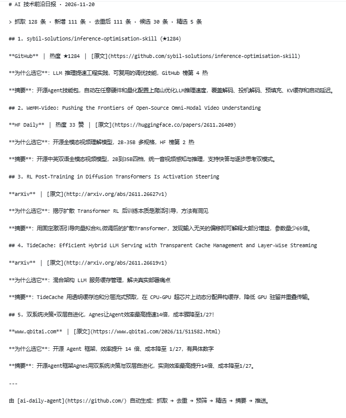
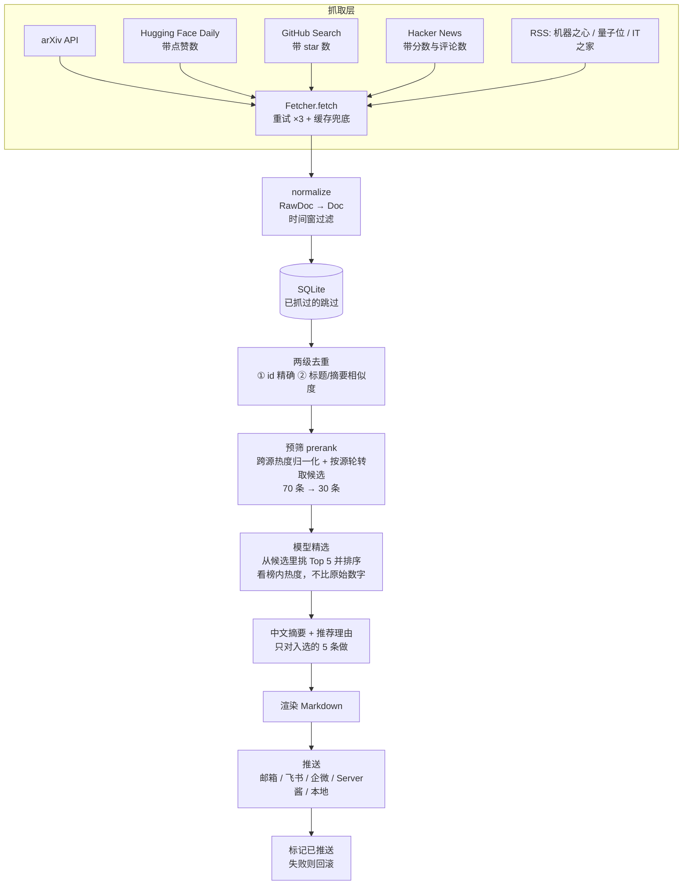

# ai-daily-agent

> 每天自动抓取 AI 前沿资讯 → 去重 → 预筛 → **让模型按热度与相关度挑出 5 条** → 生成中文日报 → 推送到邮箱。


一个**可离线运行、没有 API Key 也能跑通链路**的 AI 资讯日报 Agent。

> **运行现状**（跑在 GitHub Actions，每天北京时间 08:00 自动执行）
> 抓取约 100 条 → 去重 + 预筛 30 条候选 → 模型精选 5 条 → 生成中文摘要 → 邮件推送，单次约 20 秒，成本不到 0.1 元。

<!-- 收到日报后把截图存到 docs/screenshot.png，然后删掉下面这行的注释，仓库首页会好看很多 -->
<!--  -->

它要解决的不是"调个模型总结新闻"，而是四件容易做错的事：

- 同一篇论文被 arXiv、Hugging Face、公众号同时发 → **两级去重**
- 抓 70 条不该让模型评测 70 条 → **规则预筛**，只把 30 条候选送进去
- 让模型"逐条打 1-5 分"它会给每条都打 4 分 → **改成从候选里直接挑 Top 5 并排序**
- 抓取一定会失败（限流、改版、断网）→ **重试 + 缓存兜底 + 失败回滚**

## 数据源

| 源 | 内容 | 热度信号 | 默认 | 备注 |
| --- | --- | --- | --- | --- |
| arXiv | cs.AI / cs.CL / cs.LG / cs.CV 最新论文 | ❌ 无 | ✅ | 官方 Atom API，最稳 |
| Hacker News | 技术圈热帖 | ✅ **points + 评论数** | ✅ | Algolia 官方 API，最客观的热度 |
| GitHub | 近期涨星的 AI 仓库 | ✅ star 数 | ✅ | 官方 search API（非网页 trending） |
| RSS | 机器之心 / 量子位 / IT之家 | ❌ 无 | ✅ | 标准库解析，一器多吃 |
| Hugging Face Daily | 社区热论文 | ✅ 点赞数 | ✅ | 国内常超时，会自动回退缓存 |
| Reddit | r/LocalLLaMA、r/MachineLearning | ✅ 赞 + 评论 | ⭕ 需代理 | 国内直连常被重置 |
| HF 模型榜 | 开源模型发布 | ✅ likes + downloads | ⭕ 需代理 | huggingface.co 同域名 |

开关在 `.env`：

```ini
# 默认五个源
SOURCES=arxiv,huggingface,github,rss,hackernews

# 有代理时把这两个也加上（信息密度很高）
SOURCES=arxiv,huggingface,github,rss,hackernews,reddit,hf_models
```

临时试某个源：`python -m aidaily --sources arxiv,hackernews --dry-run`

**没浏览量的源就不给热度**——arXiv 和 RSS 没有公开的阅读数据，宁可留空让模型按"是否被多源覆盖"判断，也不编造数字。

## 为什么结果不会全是 GitHub（踩过的坑）

第一版上线后，推送的 5 条里 4 条是 GitHub 仓库。查下来不是抓取问题（库里 arXiv 40 条、GitHub 27 条），
而是**我把不同源的热度放进了同一个量纲**：GitHub star 动辄几千，HN 分数几百，arXiv/RSS 是 0。
谁的数字大谁赢，模型当然优先选 star 高的。

两处修正：

**1. 热度换算成「本榜内百分位」**（`prerank.annotate_heat`）
不再比 `5764` 和 `1070`，而是各自换算成"在自己这个源里排第几"。
`★5764` 和 `🔥1070` 都变成"本榜第 1 热"，谁更值得看交给内容判断。

**2. 候选池按源轮转分配**（`prerank._balanced_pick`）
只按总分取前 30，40 条 arXiv 会把小源挤没；改成按源轮转，每个源都保证有候选位。

**3. prompt 里明确"不同来源的数字不可直接比较"**，并要求同一来源最多占 2 条。

> 面试价值：这是"**指标可加性**"问题——不同量纲的数值不能直接比较，
> 要么归一化，要么转成同类内的序。说清这一点，比说"我调了 prompt"有说服力。

## 数据流



一次真实运行的样子：

```
抓取 71 条 → 规范化 71 条 → 新增 10 条（其余在库里）
  → 去重 10 条 → 预筛 10 条（不足 30 直接全送）
  → 1 次模型调用挑出 5 条 → 5 次摘要 → 推送
```

## 快速开始

```bash
git clone <your-repo-url> ai-daily-agent
cd ai-daily-agent
python -m venv .venv
.venv\Scripts\activate          # Windows；macOS/Linux 用 source .venv/bin/activate
pip install -r requirements.txt

copy .env.example .env          # 填 API Key；不填也能跑 mock 模式

python -m aidaily --demo        # ① 不联网不花钱，验证链路
python -m aidaily --check       # ② 自检：打印生效配置 + 真调一次模型
python -m aidaily --dry-run     # ③ 真抓取，只看结果不推送
python -m aidaily               # ④ 正式跑：抓取 + 精选 + 推送
```

想看产出长什么样，不用跑：直接看 [`examples/sample-digest.md`](examples/sample-digest.md)。

## 命令行

| 参数 | 作用 |
| --- | --- |
| `--demo` | 用内置示例数据跑完整链路，不联网、不花钱（写独立 `data/demo.db`） |
| `--check` | 打印实际读到的配置（含 `.env` 路径、key 脱敏），并试调一次模型 |
| `--dry-run` | 真抓取，但不推送、不标记已推 |
| `--top N` | 精选几条（默认 5） |
| `--max-candidates N` | 送模型挑选的候选条数（默认 30，越小越省钱） |
| `--sources a,b` | 临时指定数据源，如 `--sources arxiv,hackernews` |
| `-v` | 调试日志 |

## 目录结构

```
ai-daily-agent/
├── aidaily/
│   ├── __main__.py         # CLI：--demo / --check / --dry-run / --top / --max-candidates
│   ├── main.py             # 主流程编排：抓取→去重→预筛→精选→摘要→推送（含失败回滚）
│   ├── config.py           # 全部配置（pydantic-settings，从 .env 读）
│   ├── models.py           # 领域模型：RawDoc / Doc / RankResult / DigestItem
│   ├── db.py               # SQLite：已推去重、精选落库、失败回滚、老库自动补列
│   ├── llm.py              # LLM 双后端（langchain / http）+ JSON 清洗 + mock + 自动降级
│   ├── keywords.py         # AI 关键词表（英文按词边界匹配）
│   ├── samples.py          # 离线示例数据（demo 与测试共用）
│   ├── fetchers/           # 抓取层
│   │   ├── base.py         #   重试 + 缓存兜底 + 统一 UA/超时
│   │   ├── arxiv.py        #   Atom XML 解析
│   │   ├── huggingface.py  #   Daily Papers（带点赞数）
│   │   ├── hf_models.py    #   开源模型榜（likes / downloads）⭕ 需代理
│   │   ├── github.py       #   官方 search API（带 star 数，非网页 trending）
│   │   ├── hackernews.py   #   HN 热帖（分数 + 评论数）
│   │   ├── reddit.py       #   r/LocalLLaMA 等（赞 + 评论）⭕ 需代理
│   │   └── rss.py          #   标准库解析 RSS 2.0 / Atom，一器吃多源
│   ├── pipeline/           # 处理层
│   │   ├── dedup.py        #   两级去重（id 精确 + Jaccard 近重复）
│   │   ├── prerank.py      #   热度归一化 + 按源轮转取候选
│   │   ├── select.py       #   模型精选：挑 Top N 并排序（带兜底）
│   │   ├── summarize.py    #   中文摘要 + 推荐理由
│   │   └── render.py       #   Markdown 日报渲染
│   └── notifiers/          # 推送层：console / email / feishu / wecom / serverchan
├── eval/                   # 可选：用人工标注集评测「精选命中率」
├── tests/                  # 63 个用例
├── docs/实现指南.md         # 从零搭建的分阶段指南
└── .github/workflows/      # 每天定时跑
```

## 每个模块在解决什么问题

| 模块 | 一句话职责 | 关键实现 |
| --- | --- | --- |
| `fetchers/base.py` | 抓取一定会失败，所以要能重试、能兜底 | 指数退避 3 次 → 读上次成功缓存 |
| `fetchers/github.py` | 网页 trending 一周就挂，改用官方接口 | search API + star 数当热度 |
| `fetchers/rss.py` | 一个抓取器吃多个源，坏一个不影响其他 | 标准库同时支持 RSS 2.0 / Atom |
| `db.py` | 同一篇不要推两次 | `id` 主键 + `digest_date` 标记已推 + 失败回滚 |
| `pipeline/dedup.py` | 跨源转载的同一内容只留一条 | id 精确去重 → 字符 bigram Jaccard |
| `pipeline/prerank.py` | 70 条不该全送模型 | 关键词 + 来源权重 + 热度对数 + 新鲜度 |
| `pipeline/select.py` | 让模型做"相对选择"而不是"绝对打分" | 候选带编号与热度，返回 Top N + 理由；越界/漏选自动补齐 |
| `pipeline/summarize.py` | 只给入选的 5 条写摘要 | 与精选分开调用，成本可控 |
| `llm.py` | 换模型不改业务代码 | ChatOpenAI 与 requests 两条后端，SDK 报错自动切换 |
| `main.py` | 串起全流程 + 失败回滚 | 整轮失败时删掉本轮入库条目，避免内容被"吃掉" |

## 设计取舍

**1. 为什么让模型"挑"而不是"打分"？**
实测同一个候选集：逐条打 1-5 分时，模型倾向于给每条都打 4 分（慷慨但没用），再设阈值也很难分开；改成"从 30 条里挑 5 条并排序"，它必须做取舍，判断明显更准。**排序是模型擅长的，绝对评分不是。**

**2. 为什么还要预筛？**
精选要通读候选，候选越多越贵、注意力越散。规则预筛用关键词、来源权重、热度、新鲜度砍到 30 条，成本降一个数量级，效果几乎不变。

**3. 热度从哪里来？**
只要源给了客观数字就用：GitHub 的 star、HN 的分数与评论数、HF 的点赞。arXiv 与 RSS 没有浏览数据，就把字段留空——**不编造看不到的数字**。而且这些数字**不能直接比大小**（star 几千 vs HN 几百），一律换算成"本榜第几热"再用，详见上一节。

**4. 为什么去重要做两层？**
`id` 精确去重解决"同一 url/标题重复抓取"，几乎零成本；相似度去重解决"同一篇论文被转载、标题被改写"。只做前者会漏，只做后者慢且容易误伤。

**5. 为什么保留两套 LLM 后端？**
`langchain-openai` 与 `openai` SDK 版本组合不兼容时会出现 `process() takes no keyword arguments`（请求 200 但解析响应崩）。`LLM_BACKEND=http` 用 requests 直连可绕过，且运行时能自动降级。

**6. 为什么失败要回滚？**
整轮失败时，内容已经写进库，下次会被当成"抓过了"而永久跳过。回滚保证了"今天失败，明天还能补"。

## 成本

每天抓 70~100 条，但**不会全送模型**：

| 环节 | 做法 | 效果 |
| --- | --- | --- |
| 关键词粗筛 | RSS 先按 AI 关键词过滤 | 砍掉一半无关新闻 |
| 预筛 | 规则排序取前 30 | 70 → 30 |
| 精选 | 一次调用挑 5 条 | 30 条候选 → 1 次请求 |
| 摘要 | 只对 5 条做 | 5 次短请求 |

粗略估算（DeepSeek）：一次精选（30 条候选约 1.5 万 input token）+ 5 次摘要，**一天不到 0.05 元**。

想更省：`--max-candidates 15`，或把 `MAX_CANDIDATES` 调小。

## 评测（可选）

主流程不需要标注，但如果你想量化"模型挑得准不准"，`eval/` 提供了最小闭环：

```bash
python -m eval.export_for_labeling --add 100   # 从库里导出待标注清单
python -m eval.label_tool                      # 终端里按 1/0 标注
python -m eval.run_eval                        # 算「精选 5 条里命中几条」
```

输出：`precision@N`（精选里值得看的比例）、`recall@N`、以及**比随机挑好多少**。
随机基线 = 正样本占比，所以只要 `比随机好多少 > 0`，就说明模型的选择有价值。

## 每天早上自动运行（不用开终端）

两种方式，按"电脑开不开"选：

### 方式 A：GitHub Actions（推荐，电脑可以关机）

仓库自带 `.github/workflows/daily.yml`，每天 **UTC 00:00 = 北京时间 08:00** 自动跑。

1. 把仓库推到 GitHub（`git push` 后确认 `.github/` 目录在仓库里）
2. 仓库 `Settings → Secrets and variables → Actions → New repository secret`，逐个添加：

| Secret | 必填 | 说明 |
| --- | --- | --- |
| `LLM_API_KEY` | ✅ | DeepSeek 等平台的 key |
| `LLM_BASE_URL` | ✅ | 如 `https://api.deepseek.com/v1` |
| `LLM_MODEL` | ✅ | 如 `deepseek-chat` |
| `NOTIFY_CHANNEL` | ✅ | `email` / `feishu` / `wecom` / `serverchan` |
| `SMTP_USER` / `SMTP_PASS` / `MAIL_TO` | 用邮件时 | `SMTP_PASS` 是邮箱授权码 |
| `SMTP_HOST` / `SMTP_PORT` | 可选 | 默认 `smtp.qq.com` / `465` |
| `FEISHU_WEBHOOK` / `WECOM_WEBHOOK` / `SERVERCHAN_KEY` | 用对应渠道时 | |
| `LLM_BACKEND` | 可选 | 遇到 SDK 兼容错误就填 `http` |

3. `Actions → daily → Run workflow` 手动跑一次，确认变绿、邮箱能收到

> 两个坑要知道：
> - GitHub 的定时任务**可能延迟 15–30 分钟**（高峰期排队），不是精准 8:00
> - 公开仓库连续 60 天无提交，定时任务会被自动停用，提交一次即可恢复

### 方式 B：Windows 任务计划程序（电脑要开着）

在项目根目录执行一次（**不需要管理员**）：

```powershell
powershell -ExecutionPolicy Bypass -File scripts\install_scheduled_task.ps1
```

默认每天 08:00 运行，解释器自动检测（优先 `.venv`，否则用 PATH 里的 python）。
想换时间或指定解释器：

```powershell
powershell -ExecutionPolicy Bypass -File scripts\install_scheduled_task.ps1 -Time 08:30 -Python C:\Python312\python.exe
```

管理命令：

```powershell
Get-ScheduledTask -TaskName ai-daily-agent | Get-ScheduledTaskInfo   # 看上次结果
Start-ScheduledTask -TaskName ai-daily-agent                        # 立刻试跑一次
Get-Content data\logs\daily.log -Tail 40                            # 看日志
Unregister-ScheduledTask -TaskName ai-daily-agent -Confirm:$false   # 卸载
```

**注意**：任务只在电脑开机且已登录时触发；睡眠中不会执行（可用 `-StartWhenAvailable` 补跑，脚本已启用）。

### 方式 C：云服务器 / 免费 PaaS

把仓库 clone 到服务器后加一条 cron：

```bash
crontab -e
0 8 * * * cd /path/to/ai-daily-agent && .venv/bin/python -m aidaily >> data/logs/daily.log 2>&1
```

适合想 7×24 稳定运行、或者本地网络访问 GitHub/HF 不稳的情况。

## 常见问题

**1. 报 `process() takes no keyword arguments`**

`langchain-openai` 与 `openai` SDK 版本不兼容（请求 200，解析响应崩）。
程序会自动降级到 HTTP 后端；想手动指定就加 `LLM_BACKEND=http`，或把依赖锁回 `langchain-core<0.4` / `langchain-openai<0.3` / `openai<2`。

**2. 企业微信找不到「群机器人」/ 飞书提示要认证收费**

| 入口 | 费用 |
| --- | --- |
| 飞书客户端 → 群设置 → 群机器人 → 自定义机器人 | 免费（你要的是这个） |
| 飞书开放平台 → 创建自建应用 | 要企业认证（做正经应用才用） |
| 企业微信群机器人 | 免费，但只在**企业内部群**里有 |

个人项目推荐顺序：**邮件** > 飞书自定义机器人 > Server 酱 > 企业微信。

**3. 精选 0 条 / 全是兜底内容**

看日志有没有 `模型精选失败`。若模型不可用，程序会报错退出并回滚，而不是推一份没人挑过的日报。

**4. 抓到了但一条都不选**

`data/aidaily.db` 记住了"抓过哪些"，删掉重跑即可：`del data\aidaily.db`。

**5. Hugging Face 连不上**

国内网络直连不通，正常。抓取层会重试后回退缓存，其他源照常出报。

## 已知局限

- GitHub 源用 search API 近似"涨星榜"，未认证限速 10 次/分钟。
- arXiv / RSS 没有浏览量数据，热度只能靠"被多源覆盖"间接判断。
- 按源轮转取候选会牺牲一点"整体最优"：如果某天 arXiv 特别出色，也会给小源留位置。
- 中文源只取 RSS summary，没抓正文，长文理解有限。
- 精选完全依赖模型判断，没有人工复核环节（Roadmap 第一条）。

## Roadmap

- [ ] 推送前生成"草稿"，一键确认后再发送
- [ ] 加一个 Web 页面（FastAPI + 单页），按主题筛选历史日报
- [ ] 跨天去重：与近 30 天已推内容做向量比对，减少重复选题
- [ ] 为 arXiv 增加引用量/代码仓库可用性作为热度代理

## License

MIT
